# Protocolo de Colaboracion Dual: Antigravity & Claude

Este documento formaliza la division de trabajo, el ciclo de vida de tareas y el mecanismo de relevo asincrono entre **Antigravity** (Agente Implementador y DevOps en IDE) y **Claude** (Agente Arquitecto y Auditor de Calidad en Aplicacion Windows).

---

## 1. Roles y Responsabilidades

```mermaid
flowchart LR
    subgraph Antigravity["ANTIGRAVITY (IDE / Terminal)"]
        A1["Lectura de Workspace"]
        A2["Escritura de Codigo"]
        A3["Compilacion y Tests"]
        A4["Despliegue Docker / AWS"]
        A5["Generacion de Relevo"]
    end

    subgraph Usuario["USUARIO (Puntos de Control)"]
        U1["Aprobacion de Diseno"]
        U2["Paso de Relevo a Claude"]
        U3["Autorizacion de Commits"]
    end

    subgraph Claude["CLAUDE (App Windows / Desktop)"]
        C1["Diseno Arquitectonico"]
        C2["Deteccion Casos Borde"]
        C3["Auditoria de Seguridad"]
        C4["Revision de Git Diff"]
        C5["Dictamen Estructurado"]
    end

    Antigravity -->|"Prepara colaboracion/relevo.md"| Usuario
    Usuario -->|"Traspasa relevo"| Claude
    Claude -->|"Emite Dictamen Tecnico"| Usuario
    Usuario -->|"Autoriza aplicacion"| Antigravity
```



### 1.1 Rol de Claude (Lead Software Architect & QA Auditor)
- **Ambiente:** Aplicacion de escritorio de Claude en Windows (Claude 3.5 / 3.7 Sonnet).
- **Responsabilidades:**
  1. **Diseno de Dominio:** Definir contratos de datos, patrones de diseno y estructuras antes de codificar.
  2. **Casos Borde y Excepciones:** Identificar escenarios no previstos (valores limite, concurrencia, timeouts).
  3. **Auditoria de Seguridad y Calidad:** Revisar los diffs generados por Antigravity en `colaboracion/diffs/` buscando vulnerabilidades, inyecciones, o violaciones a Spring Security y OWASP.
  4. **Emision de Dictamen:** Emitir veredictos estructurados (`APROBADO`, `REQUIERE_AJUSTES`, `RECHAZADO`) archivados en `colaboracion/dictamenes/`.

### 1.2 Rol de Antigravity (Senior Software Engineer & DevOps Operator)
- **Ambiente:** Entorno de desarrollo local (IDE, PowerShell, Docker, Git, AWS CLI, SSH).
- **Responsabilidades:**
  1. **Implementacion de Codigo:** Modificar y crear archivos de codigo fuente en Spring Boot, Angular y SQL.
  2. **Verificacion Activa:** Ejecutar compilaciones (`mvn`, `npm`) y pruebas unitarias/integracion.
  3. **Control de Infraestructura:** Levantar y sincronizar contenedores Docker y validar instancias en AWS EC2.
  4. **Generacion del Archivo de Relevo:** Empaquetar el estado de cada tarea en `colaboracion/relevo.md` y diffs en `colaboracion/diffs/` para Claude.
  5. **Cumplimiento de Reglas:** Gestionar ramas por issue, mensajes convencionales y plantillas de PR con autorizacion previa.

---

## 2. El Ciclo de Relevo en 4 Fases

### Fase 1: Planteamiento y Diseno (Claude)
1. Para funcionalidades complejas, Antigravity prepara el archivo `colaboracion/relevo.md` describiendo el problema, las opciones analizadas y las preguntas de arquitectura.
2. El usuario traslada el relevo a Claude en su aplicacion de Windows.
3. Claude entrega el dictamen tecnico con la opcion recomendada y lineamientos de diseno (archivado en `colaboracion/dictamenes/`).

### Fase 2: Implementacion y Validacion de Entorno (Antigravity)
1. El usuario pega el dictamen de Claude en el chat de Antigravity y autoriza su implementacion.
2. Antigravity crea la rama correspondiente (`<tipo>/<nombre>-issue-<N>`).
3. Antigravity codifica la solucion, compila los proyectos y ejecuta pruebas automatizadas.
4. Si la compilacion o pruebas fallan, Antigravity corrige los errores de sintaxis y dependencias hasta alcanzar una construccion limpia.

### Fase 3: Auditoria de Codigo (Claude)
1. Al terminar la implementacion, Antigravity actualiza `colaboracion/relevo.md` y genera el unificado en `colaboracion/diffs/git_diff_issue_<N>.diff` con los resultados de ejecucion.
2. El usuario entrega el archivo actualizado a Claude en Windows.
3. Claude actua como revisor de PR externo: audita el codigo e indica si existen ajustes de seguridad o calidad requeridos.

### Fase 4: Autorizacion, Despliegue y Commit (Antigravity & Usuario)
1. El usuario presenta el dictamen final de Claude a Antigravity.
2. Si se requieren ajustes menores, Antigravity los aplica.
3. Antigravity solicita al usuario la aprobacion final para commitear.
4. Con el consentimiento explícito del usuario, Antigravity ejecuta el commit convencional en espanol, realiza el push a GitHub y entrega la plantilla oficial de Pull Request.

---

## 3. Formato Estandarizado del Archivo de Relevo (`colaboracion/relevo.md`)

Todo archivo de relevo generado por Antigravity sigue estrictamente la siguiente estructura:
- **Cabecera:** Numero de Issue, Titulo, Responsables y Fase actual.
- **Contexto y Problema:** Descripcion tecnica clara del requerimiento.
- **Implementacion / Propuesta:** Codigo fuente o diff involucrado.
- **Pruebas y Evidencias:** Estado de la compilacion y resultados de tests.
- **Preguntas de Auditoria:** Puntos especificos sobre los que Claude debe pronunciarse.

---

## 4. Formato de Respuesta Exigido a Claude

Claude debe responder de manera uniforme utilizando el siguiente encabezado para facilitar el traspaso:

```markdown
### DICTAMEN DE RELEVO: [APROBADO | REQUIERE_AJUSTES | RECHAZADO]

#### 1. Evaluacion de Arquitectura y Seguridad
[Analisis conciso de riesgos, vulnerabilidades y buenas practicas]

#### 2. Casos Borde Identificados
[Lista de escenarios criticos a controlar]

#### 3. Directivas de Implementacion para Antigravity
[Instrucciones tecnicas precisas y fragmentos de codigo drop-in]
```
